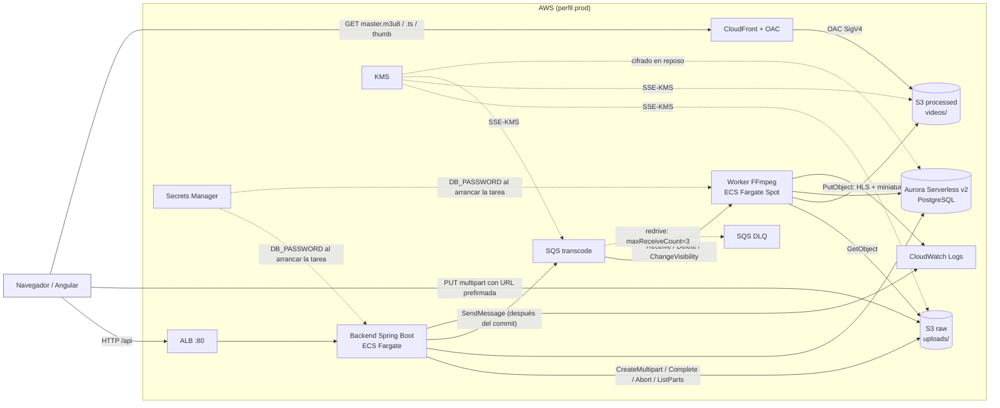
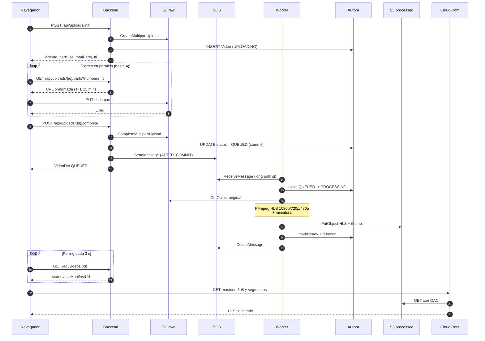
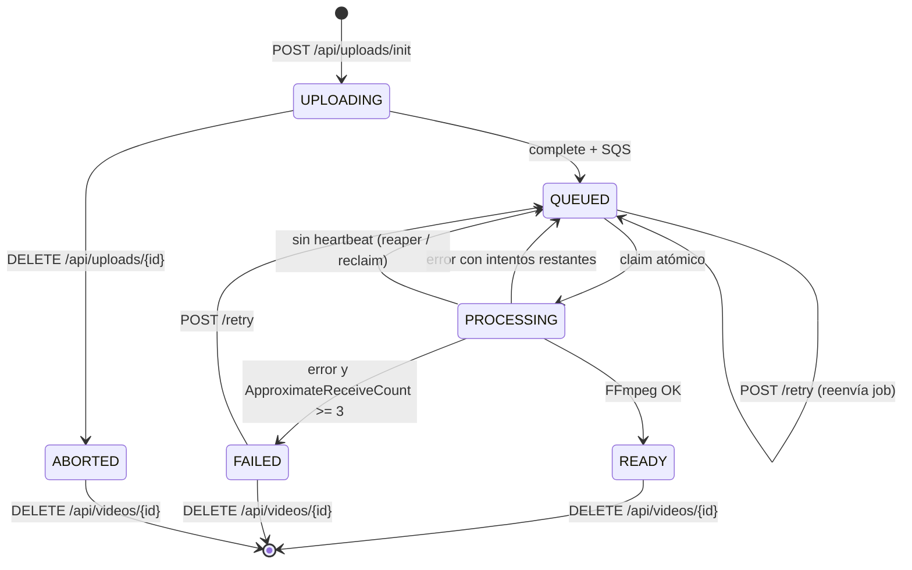

# Servicios de AWS y su impacto en video-platform

Documento técnico del uso de servicios AWS en el proyecto: qué hace cada uno, dónde se
configura, cómo afecta al flujo de subida/reproducción y qué ocurre si falla.

- **Alcance:** backend Spring Boot, worker FFmpeg, frontend Angular e infraestructura
  Terraform (`infra/`).
- **Entornos:** AWS real (perfiles `prod`/`docker`) y emulación local con **Floci** +
  PostgreSQL para S3/SQS.
- **Audiencia:** desarrollo y operación.

## Índice

1. [Arquitectura general](#1-arquitectura-general)
2. [Flujo de una subida](#2-flujo-de-una-subida)
3. [Máquina de estados del video](#3-máquina-de-estados-del-video)
4. [Servicios AWS](#4-servicios-aws)
5. [Entornos: AWS vs local](#5-entornos-aws-vs-local)
6. [Variables de entorno](#6-variables-de-entorno)
7. [Matriz de fallos e impacto](#7-matriz-de-fallos-e-impacto)
8. [Coste y operación](#8-coste-y-operación)
9. [Hallazgos y recomendaciones](#9-hallazgos-y-recomendaciones)
10. [Referencias de código e infraestructura](#10-referencias-de-código-e-infraestructura)

---

## 1. Arquitectura general

> El frontend **no** se despliega en Terraform: solo backend y worker. El frontend puede
> alojarse en otro origen (el CORS de `S3 raw` se controla con `app_origin`).

---

## 2. Flujo de una subida

Puntos clave del flujo:

- El backend **nunca transporta el video**: solo firma URLs y confirma el multipart.
- La subida es reanudable parcialmente: `GET /parts/uploaded` consulta en S3 las partes ya
  subidas (`MultipartUploadService.listParts`).
- El mensaje SQS se publica **después** del commit de `QUEUED` mediante
  `@TransactionalEventListener(AFTER_COMMIT)` (`VideoQueuedListener.java:26`), evitando la
  carrera worker-antes-del-commit.
- El worker reclama el job de forma atómica (`VideoStatusDao.claim`) y procesa un video a
  la vez por tarea.

---

## 3. Máquina de estados del video

La tabla `videos` de Aurora es la **fuente de verdad** del estado. El estado `PROCESSING`
es el único que puede quedar "colgado" si el worker muere; para eso existen dos redes de
seguridad: el reclamo de jobs caducados por el propio worker y el reaper del backend
(ver sección 4.2).

---

## 4. Servicios AWS

### 4.1 Amazon S3

El proyecto usa **dos buckets privados** creados en `infra/s3.tf`:

| Bucket | Nombre | Contenido | Configuración relevante |
|---|---|---|---|
| raw | `${prefix}-raw-${account_id}` | Original subido (`uploads/{owner}/{videoId}/original.{ext}`) | SSE-KMS con Bucket Key, Block Public Access, `DenyInsecureTransport`, CORS con `ETag` expuesto, lifecycle |
| processed | `${prefix}-processed-${account_id}` | HLS (`master.m3u8`, `v*/index.m3u8`, `seg_*.ts`) y `thumb.jpg` (`videos/{videoId}/...`) | SSE-KMS con Bucket Key, Block Public Access, versionado, lifecycle a IA/Glacier |

Impacto en el proyecto:

- **Subida directa:** el navegador hace `PUT` contra el bucket raw con URLs prefirmadas
  (`MultipartUploadService.presignPart`). El backend no consume ancho de banda de video.
  El TTL de las URLs es 15 min (`app.presign.part-ttl: PT15M`).
- **Partes:** tamaño por defecto 8 MiB y mínimo 5 MiB (`PartSizeCalculator`), hasta 10 000
  partes. El navegador sube 4 en paralelo con reintentos
  (`frontend/src/app/core/video-upload.service.ts:15`).
- **CORS:** el bucket raw expone `ETag`; el frontend lo necesita para el
  `CompleteMultipartUpload` (`ExposeHeaders: ETag`).
- **Lifecycle del original:** aborta multipart incompletos a los 3 días y expira el
  original a los 30 días. El video reproducido vive en `processed/`.
- **Borrado:** `DELETE /api/videos/{id}` borra el original y todo el prefijo
  `videos/{videoId}/` del bucket processed (`VideoContentCleaner.java:35`).
- **Entrega:** el bucket processed es privado; solo CloudFront lo lee vía OAC.

Si S3 falla:

- `init`/`parts`/`complete` fallan y la subida no puede continuar.
- El worker falla al descargar o subir salidas y el job se reintenta hasta `FAILED`.
- La reproducción de videos `READY` falla (vía CloudFront).

### 4.2 Amazon SQS

Definido en `infra/sqs.tf` y emulado por Floci en local (`scripts/floci-init.sh`).

| Cola | Configuración | Uso |
|---|---|---|
| `transcode` | `visibility_timeout=3600`, retención 1 día, cifrado KMS, redrive a DLQ con `maxReceiveCount=3` | Jobs de transcodificación |
| `transcode-dlq` | retención 14 días, cifrado KMS, `redrive_allow_policy` | Mensajes que agotan reintentos |

Flujo e impacto:

- **Publicación:** el backend envía `ProcessingMessage {videoId, bucket, key}` después del
  commit (`ProcessingQueuePublisher.enqueue`).
- **Consumo:** el worker hace long polling (`waitTimeSeconds=20`,
  `maxNumberOfMessages=1`), de forma que una tarea procesa un video a la vez.
- **Visibilidad:** el worker extiende la visibilidad cada 5 min (`heartbeat`) y además
  actualiza `updated_at` en la BD (`SqsPoller.java:202`). Esto permite distinguir un job
  largo legítimo de un job muerto.
- **Reintentos:** ante error, el video vuelve a `QUEUED` y el mensaje se hace visible en
  30 s (`releaseSoon`), en lugar de esperar la hora completa del visibility timeout.
- **Fallo terminal:** al llegar a `maxReceiveCount=3`, se marca `FAILED` y se borra el
  mensaje; además queda copia en la DLQ si se agotó el redrive.
- **Recuperación de jobs muertos:** un mensaje reentregado puede reclamar un `PROCESSING`
  caducado (`PROCESSING_STALE_MINUTES`, 30 por defecto) aunque el worker anterior haya
  desaparecido (`VideoStatusDao.claim`).
- **Reaper del backend:** cada 2 min (`REAPER_INTERVAL_MS`) busca videos `PROCESSING` sin
  heartbeat y los devuelve a `QUEUED` republicando el job
  (`StaleProcessingReaper.requeueStaleProcessing`, `StaleProcessingReaper.java:53`). Es la
  red de seguridad para videos que ya se quedaron atascados.

Si SQS falla:

- `complete` confirma `QUEUED` en BD pero la publicación falla; el video queda `QUEUED`
  sin mensaje. Se puede relanzar con `POST /api/videos/{id}/retry` (permitido en `QUEUED`).
- El worker no recibe jobs nuevos.
- El reencolado automático necesita que el backend esté vivo y comparta BD con el worker
  (docker/prod), no en el perfil `local` con H2 separadas.

### 4.3 Amazon CloudFront + OAC

Configurado en `infra/cloudfront.tf`.

- Origen: bucket processed mediante **Origin Access Control** (SigV4).
- Política de caché gestionada `Managed-CachingOptimized`; métodos `GET`/`HEAD`;
  `redirect-to-https`; compresión activa; certificado por defecto de CloudFront.
- El bucket no es público: la política del bucket solo permite `s3:GetObject` a la
  distribución.

Impacto:

- El worker construye `hlsManifestUrl` y `thumbnailUrl` con `CLOUDFRONT_BASE_URL`
  (`StorageService.manifestUrl/thumbnailUrl`).
- En local no hay CloudFront: `CLOUDFRONT_BASE_URL=http://localhost:4566/video-processed`
  apunta directamente a S3 emulado.
- CloudFront no interviene en el procesamiento; si falla, los videos siguen
  procesándose pero no se reproducen.

### 4.4 Amazon ECS Fargate y ECR

Definido en `infra/ecs.tf` y `infra/ecr.tf`.

| Servicio | CPU / Memoria | Deseado | Notas |
|---|---|---|---|
| backend | 256 (0.25 vCPU) / 512 MiB | 1 | Detrás del ALB, subredes privadas, sin IP pública |
| worker | 2048 (2 vCPU) / 4096 MiB | **0** | Fargate **Spot**, 50 GiB efímeros, autoscaling 0..`worker_max_tasks` (10) |

Impacto:

- **Escala a cero:** sin videos no hay tareas de worker ni coste de cómputo.
- **Arranque en frío:** el primer video puede tardar más por el escalado (alarma de cola +
  arranque de tarea + pull de imagen + FFmpeg).
- **Paralelismo:** cada tarea procesa un video a la vez; el paralelismo real es el número
  de tareas (hasta 10 por defecto).
- **Autoscaling:** alarmas de CloudWatch sobre `ApproximateNumberOfMessagesVisible`
  (escala +2 cuando ≥1 mensaje visible; escala -10 cuando la cola está vacía).
- **ECR:** repositorios `backend` y `worker`, escaneo al publicar, tags mutables y lifecycle
  que conserva las 10 imágenes más recientes.
- **Worker:** la imagen incluye FFmpeg/ffprobe (`worker/Dockerfile`) y limita la JVM al 75 %
  de la RAM (`JAVA_TOOL_OPTIONS=-XX:MaxRAMPercentage=75.0`).

### 4.5 Amazon Aurora Serverless v2 (PostgreSQL)

Definido en `infra/aurora.tf`.

- Motor Aurora PostgreSQL en modo provisioned con `serverlessv2_scaling_configuration`
  (0..4 ACU) y una instancia `db.serverless`.
- Almacenamiento cifrado con KMS; contraseña maestra gestionada por Secrets Manager
  (`manage_master_user_password = true`).
- `skip_final_snapshot = true`; sin réplicas.
- Esquema gestionado por Flyway en backend (`backend/src/main/resources/db/migration`) y
  `schema.sql` para H2 local del worker.

Impacto:

- Es la **fuente de verdad** del estado y metadatos (`size_bytes`, `duration_seconds`,
  `hls_manifest_url`, `error_message`).
- Backend y worker comparten la misma BD (imprescindible para `claim`, `markReady`,
  reaper y reclamación de jobs caducados).
- Si Aurora falla, la API devuelve errores y el worker no puede reclamar ni finalizar
  jobs. Los objetos en S3 no se pierden.

### 4.6 AWS Secrets Manager

- Terraform hace que Aurora gestione su contraseña maestra como secreto.
- Las definiciones de tarea ECS inyectan `DB_PASSWORD` desde ese secreto mediante la
  **execution role** (no la task role).
- Impacto: no hay contraseñas en variables de entorno ni en la imagen; rotación gestionable
  por Aurora.

### 4.7 AWS KMS

- Una CMK `${prefix}` (`infra/kms.tf`) con rotación anual.
- Se usa para: SSE-KMS en ambos buckets S3 (con **Bucket Keys**), cifrado de SQS, cifrado
  del almacenamiento de Aurora y del secreto.
- Impacto:
  - Seguridad en reposo y en tránsito interno.
  - Las Bucket Keys reducen ~99 % las llamadas a KMS en S3.
  - Las tareas en subredes privadas **necesitan** alcanzar KMS (ver hallazgo en la sección
    9).

### 4.8 AWS IAM

Dos roles de ejecución y dos de tarea (`infra/iam.tf`), sin credenciales estáticas:

| Rol | Permisos principales |
|---|---|
| `backend-execution` | `AmazonECSTaskExecutionRolePolicy` + `secretsmanager:GetSecretValue` + `kms:Decrypt` |
| `backend-task` | S3 multipart sobre raw/uploads, `sqs:SendMessage`, `kms:GenerateDataKey`/`Decrypt` |
| `worker-execution` | Igual que backend-execution |
| `worker-task` | `s3:GetObject` sobre raw/uploads, `s3:PutObject`/`DeleteObject` sobre processed, SQS `Receive/Delete/ChangeVisibility/GetQueueAttributes`, KMS |

Impacto:

- **Mínimo privilegio y separación:** el backend no lee salidas HLS; el worker no publica
  jobs ni gestiona multipart.
- El navegador hereda los permisos de la **task role del backend** al usar una URL
  prefirmada (S3 valida la identidad que firmó).
- Los contenedores obtienen credenciales temporales del rol de tarea, no hay claves.

> Hay un desajuste conocido entre `VideoContentCleaner` y la policy `backend-task`; se
> detalla en la sección 9.

### 4.9 Amazon CloudWatch

- Log groups `/ecs/${prefix}-backend` y `/ecs/${prefix}-worker`, retención 14 días.
- Alarmas `ApproximateNumberOfMessagesVisible` que disparan el Application Auto Scaling
  del worker.
- El ALB usa `/actuator/health` del backend como health check.
- El worker no expone HTTP (`spring.main.web-application-type: none`), por lo que no tiene
  health check HTTP; su salud se infiere de los logs y de que siga consumiendo SQS.

### 4.10 Amazon VPC Endpoints y red

Definido en `infra/network.tf`.

- VPC `10.20.0.0/16` con 2 subredes privadas y 2 públicas; **sin NAT Gateway**.
- **Gateway endpoint** para S3 (gratuito).
- **Interface endpoints** para `sqs`, `ecr.api`, `ecr.dkr`, `logs` y `secretsmanager`.
- Security groups: ALB 80 público; backend 8080 solo desde el ALB; worker sin ingress; BD
  5432 solo desde backend y worker; endpoints 443 desde la VPC.

Impacto:

- Las tareas viven en subredes privadas sin salida a Internet, así que **todo** servicio
  AWS que usen debe tener endpoint (o ir por el gateway de S3).
- ECR funciona con `ecr.api` + `ecr.dkr` + S3 (capas).
- El worker descarga/sube video por el gateway de S3, sin coste de NAT.

### 4.11 Application Load Balancer

- ALB público con listener HTTP:80 que reenvía al target group `backend:8080`
  (`infra/alb.tf`).
- Health check `/actuator/health` cada 30 s.
- Impacto: punto único de entrada de la API; no enruta al frontend ni al worker. En el
  estado actual es **HTTP**, sin listener TLS.

### 4.12 Cognito / proveedor OIDC

- En `prod`, el backend se comporta como resource server JWT:
  `SecurityConfig` valida el `issuer-uri` (`JWT_ISSUER`) y convierte el claim
  `cognito:groups` en authorities `ROLE_*`.
- En `local`/`docker` la autenticación está desactivada y se toma el usuario de
  `X-User-Id` (`LocalSecurityConfig`).
- Terraform **no crea** el user pool: Cognito (u otro OIDC) es una dependencia externa
  configurada con `jwt_issuer`.
- Impacto:
  - `Principal.getName()` es el `sub` del token (o el header en local) y se usa como
    `owner_id`; cada usuario solo ve sus videos.
  - Los controladores no comprueban roles: cualquier token válido puede operar sobre sus
    propios recursos.

### 4.13 Servicios que NO se usan

| Servicio | Alternativa usada | Motivo |
|---|---|---|
| AWS Lambda | Worker ECS + FFmpeg | Control del binario, límites de tiempo/memoria y coste predecible |
| MediaConvert / Elastic Transcoder | FFmpeg en el worker | Sin dependencia de servicio gestionado; mismo resultado HLS |
| API Gateway | ALB | Menos componentes y coste |
| NAT Gateway | VPC Endpoints | Ahorro (~32 USD/mes) y tráfico privado |
| RDS Proxy | Pool Hikari pequeño | Carga baja y conexiones cortas |

---

## 5. Entornos: AWS vs local

| Aspecto | AWS (`prod`) | Local (`docker-compose`) |
|---|---|---|
| S3 | Buckets reales con KMS | Floci (`localhost:4566`), storage en memoria |
| SQS | Colas reales con KMS y DLQ | Floci, colas `transcode-queue`/`transcode-dlq` |
| Base de datos | Aurora Serverless v2 | PostgreSQL 16 en contenedor |
| Cómputo | ECS Fargate / Spot | Contenedores locales |
| Entrega HLS | CloudFront + OAC | `http://localhost:4566/video-processed` |
| Autenticación | JWT (Cognito/OIDC) | Header `X-User-Id` |
| Secretos | Secrets Manager | Variables de entorno en compose |
| KMS/IAM/CloudWatch | Servicios reales, roles de tarea | No emulados (Floci solo S3/SQS) |

Detalle importante en local:

- `AWS_ENDPOINT=http://floci:4566` es el endpoint **desde los contenedores**.
- `AWS_PRESIGN_ENDPOINT=http://localhost:4566` es el endpoint que se firma en las URLs
  porque el `PUT` lo ejecuta el **navegador del host**. Si ambos no se separan, el
  navegador no puede alcanzar `floci:4566`.
- Floci guarda en memoria (`FLOCI_STORAGE_MODE=memory`): los objetos se pierden al
  reiniciar el contenedor.

---

## 6. Variables de entorno

### Backend

| Variable | Default / valor | Uso |
|---|---|---|
| `SPRING_PROFILES_ACTIVE` | `prod` en ECS, `docker` en compose | Selecciona configuración y seguridad |
| `DB_URL`, `DB_USER`, `DB_PASSWORD` | — / secreto | Aurora |
| `AWS_REGION` | `eu-west-1` | SDK AWS |
| `AWS_ENDPOINT` | vacío en AWS; `http://floci:4566` en local | Override de endpoint (S3/SQS) |
| `AWS_PRESIGN_ENDPOINT` | vacío en AWS; `http://localhost:4566` en local | Host de las URLs prefirmadas |
| `RAW_BUCKET`, `PROCESSED_BUCKET` | — | Buckets S3 |
| `TRANSCODE_QUEUE_URL` | — | Cola SQS |
| `JWT_ISSUER` | — (obligatorio en `prod`) | Issuer OIDC |
| `PRESIGN_PART_TTL` | `PT15M` | TTL de URLs de partes |
| `PRESIGN_MAX_URLS` | `1000` | Máx. URLs por petición |
| `UPLOAD_MIN_PART_SIZE` | `5242880` (5 MiB) | Tamaño mínimo de parte |
| `UPLOAD_DEFAULT_PART_SIZE` | `8388608` (8 MiB) | Tamaño por defecto de parte |
| `UPLOAD_MAX_PARTS` | `10000` | Límite de partes |
| `REAPER_ENABLED` | `true` | Activa el reaper de `PROCESSING` |
| `PROCESSING_STALE_MINUTES` | `30` | Umbral de job caducado (worker y reaper) |
| `REAPER_INTERVAL_MS` | `120000` | Periodo del reaper |

### Worker

| Variable | Default / valor | Uso |
|---|---|---|
| `SPRING_PROFILES_ACTIVE` | `prod` en ECS, `docker` en compose | Configuración |
| `DB_URL`, `DB_USER`, `DB_PASSWORD` | — / secreto | Aurora |
| `AWS_REGION` | `eu-west-1` | SDK AWS |
| `AWS_ENDPOINT` | vacío en AWS; `http://floci:4566` en local | Override de endpoint |
| `RAW_BUCKET`, `PROCESSED_BUCKET` | — | Buckets S3 |
| `TRANSCODE_QUEUE_URL` | — | Cola SQS |
| `CLOUDFRONT_BASE_URL` | dominio CloudFront en prod; `http://localhost:4566/video-processed` en local | Base de `hlsManifestUrl`/`thumbnailUrl` |
| `WORKER_ENABLED` | `true` | Activa el poller |
| `WORKER_HEARTBEAT_MINUTES` | `5` | Periodo de heartbeat |
| `PROCESSING_STALE_MINUTES` | `30` | Reclaim de `PROCESSING` |
| `WORKER_WORK_DIR` | vacío (tmp) / `/tmp/work` en ECS | Directorio de trabajo |
| `VISIBILITY_TIMEOUT` | `3600` | Visibility timeout de SQS |
| `MAX_RECEIVE_COUNT` | `3` | Reintentos antes de `FAILED` |
| `FFMPEG_PRESET` | `veryfast` | Preset de libx264 |

---

## 7. Matriz de fallos e impacto

| Falla | Efecto inmediato | Estado del video | Recuperación |
|---|---|---|---|
| S3 raw no disponible | `init`, `parts` o `complete` fallan | `UPLOADING` | Reintentar la subida |
| S3 processed no disponible | El worker falla al subir HLS/miniatura | `QUEUED`/`PROCESSING` → `FAILED` tras 3 intentos | `retry` |
| SQS no disponible | `complete` confirma `QUEUED` pero no publica | `QUEUED` | `POST /retry` |
| Worker caído | No se consumen mensajes | `QUEUED` | Autoscaling por alarma de cola |
| Worker muere a mitad de job | El mensaje se reentrega tras el visibility timeout | `PROCESSING` | Reclaim a los 30 min o reaper cada 2 min |
| FFmpeg falla | Error capturado y job reintentado | `QUEUED` → `FAILED` | Automático / `retry` |
| Aurora no disponible | Backend y worker no leen/escriben estado | Sin cambios | Reintentar al volver |
| CloudFront caído | Los `READY` no se reproducen | `READY` (sin cambio) | Recuperación del CDN |
| Secreto/credenciales mal | Las tareas ECS no arrancan | Sin cambio | Corregir secreto |
| Falta de endpoint KMS | Las llamadas KMS hacen timeout en subredes privadas | Uploads/jobs fallan | Añadir endpoint KMS (sección 9) |

---

## 8. Coste y operación

Resumen de decisiones que impactan directamente en la factura:

| Decisión | Servicio afectado | Efecto |
|---|---|---|
| Subida directa con URLs prefirmadas | S3 / backend | El backend no transporta video; menos cómputo y ancho de banda |
| Worker Fargate **Spot** con `desiredCount = 0` | ECS | Sin coste de worker en reposo |
| Autoscaling por `ApproximateNumberOfMessagesVisible` | SQS / ECS / CloudWatch | Escala desde cero solo cuando hay cola |
| Aurora Serverless v2 `min_capacity = 0` | Aurora | BD apagada en reposo |
| VPC Endpoints sin NAT Gateway | VPC | Ahorro estimado ~32 USD/mes |
| CloudFront + OAC sobre bucket privado | CloudFront / S3 | Entrega cacheada y bucket no público |
| Lifecycle S3: abortar multipart a 3 días, original a 30 | S3 | Limpia residuos y almacenamiento |
| `processed` a IA a 30 días y Glacier IR a 90 | S3 | Menor coste de almacenamiento a largo plazo |
| KMS Bucket Keys | KMS / S3 | Reduce ~99 % las peticiones KMS |
| DLQ con retención 14 días | SQS | Permite diagnosticar fallos sin coste alto |

---

## 9. Hallazgos y recomendaciones

Observaciones detectadas al contrastar el código con la infraestructura. **No** se han
aplicado cambios; se documentan para su revisión.

1. **Permisos de borrado incompletos en `backend-task`.** `VideoContentCleaner` ejecuta
   `ListObjectsV2`, `DeleteObjects` y `DeleteObject` sobre `processed/` y `raw/`, pero la
   policy `backend_task` (`infra/iam.tf`) solo concede acciones multipart sobre
   `raw/uploads/*`. En producción, `DELETE /api/videos/{id}` fallará con `AccessDenied`.
   Recomendación: añadir `s3:ListBucket`/`s3:ListObjectsV2` sobre processed,
   `s3:DeleteObject` sobre `processed/*` y `raw/uploads/*`.

2. **Falta el VPC Interface Endpoint de KMS.** Con S3/SQS cifrados con KMS y subredes
   privadas sin NAT, las tareas necesitan `com.amazonaws.${region}.kms`. Hoy no está en
   `local.interface_endpoints` (`infra/network.tf`), lo que puede provocar timeouts en
   operaciones S3/SQS. Recomendación: añadir `"kms"` a la lista.

3. **CORS de `processed` en producción.** Floci configura CORS en ambos buckets
   (`scripts/floci-init.sh`), pero Terraform solo define CORS para `raw`
   (`infra/s3.tf`). Si el frontend se sirve desde otro origen, la reproducción HLS con
   hls.js puede fallar por CORS. Recomendación: añadir
   `aws_s3_bucket_cors_configuration` para `processed` o una respuesta de cabeceras CORS en
   CloudFront.

4. **ALB solo HTTP.** No hay listener TLS ni certificado ACM (`infra/alb.tf`). El token JWT
   y las llamadas a la API viajarían sin cifrar. Recomendación: añadir listener 443 con ACM
   y redirección desde 80.

5. **`QUEUED` sin reaper.** El reaper solo recupera `PROCESSING`. Si SQS falla justo después
   del commit, el video queda `QUEUED` sin mensaje hasta un `retry` manual. Recomendación:
   reencolar también `QUEUED` antiguos o publicar con outbox pattern.

6. **El reaper no funciona en `local` con H2 separadas.** Backend y worker usan bases H2
   independientes; solo tiene efecto en `docker`/`prod` con PostgreSQL compartido. Es
   esperado, pero conviene tenerlo presente al depurar en local.

---

## 10. Referencias de código e infraestructura

| Tema | Archivo |
|---|---|
| Buckets, CORS, lifecycle, cifrado | `infra/s3.tf` |
| Colas y DLQ | `infra/sqs.tf`, `scripts/floci-init.sh` |
| CloudFront y OAC | `infra/cloudfront.tf` |
| ECS, autoscaling y logs | `infra/ecs.tf` |
| ECR y lifecycle de imágenes | `infra/ecr.tf` |
| Aurora y Secrets Manager | `infra/aurora.tf` |
| KMS | `infra/kms.tf` |
| IAM de ejecución y tarea | `infra/iam.tf` |
| VPC y endpoints | `infra/network.tf` |
| ALB | `infra/alb.tf` |
| Variables y salidas | `infra/variables.tf`, `infra/outputs.tf` |
| Endpoints y credenciales locales | `backend/src/main/java/com/example/video/config/AwsConfig.java`, `worker/src/main/java/com/example/worker/config/AwsConfig.java` |
| Multipart y prefirmado | `backend/src/main/java/com/example/video/service/MultipartUploadService.java` |
| Publicación SQS y AFTER_COMMIT | `ProcessingQueuePublisher.java`, `VideoQueuedListener.java` |
| Reaper de `PROCESSING` | `backend/src/main/java/com/example/video/service/StaleProcessingReaper.java` |
| Consumo SQS, claim y heartbeat | `worker/src/main/java/com/example/worker/poller/SqsPoller.java` |
| Estado en BD | `worker/src/main/java/com/example/worker/repo/VideoStatusDao.java` |
| Descarga/subida S3 | `worker/src/main/java/com/example/worker/service/StorageService.java` |
| Borrado en S3 | `backend/src/main/java/com/example/video/service/VideoContentCleaner.java` |
| Comandos FFmpeg/HLS | `worker/src/main/java/com/example/worker/service/HlsCommandBuilder.java` |
| Seguridad JWT/local | `backend/src/main/java/com/example/video/config/SecurityConfig.java`, `LocalSecurityConfig.java` |
| Compose local | `docker-compose.yml` |
